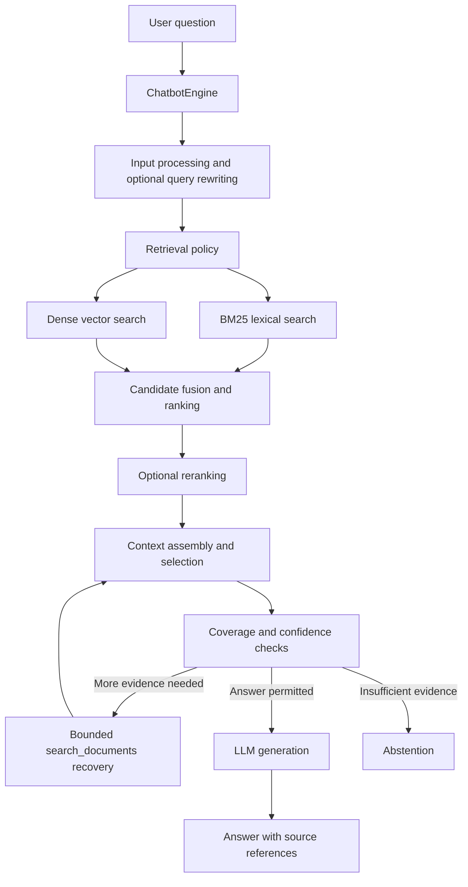

# Local RAG Chatbot

**A modular, document-grounded Q&A system built with Python, FastAPI, and hybrid retrieval.**

[](https://github.com/CosmicSheep42/RAG-Chatbot/actions/workflows/ci.yml)


This is a **software engineering and AI engineering portfolio project** exploring how to build, test, and evaluate a retrieval-augmented generation (RAG) application. The focus is not just calling an LLM: it is organizing a maintainable retrieval pipeline, supporting interchangeable infrastructure, tracing failures, and measuring what actually works.

The application runs locally with **Ollama** or uses the **OpenAI API** for generation; generation and embeddings are independently configurable. It provides a standalone web/API application and a reusable Python engine.

> **Project status:** Functional research/learning prototype, **not a production-ready hosted service**. Retrieval and infrastructure have been tested; factual answer reliability remains an active limitation. See [Evaluation and limitations](#evaluation-and-limitations).

## At a glance

| Area | Implemented |
| --- | --- |
| Retrieval | BM25, dense vector retrieval, hybrid retrieval, optional cross-encoder reranking |
| Knowledge base | Document ingestion, chunking, metadata, Chroma or PostgreSQL/pgvector |
| Generation | Ollama or OpenAI API, configurable independently of embeddings |
| Answering | Source citations, context selection, confidence/coverage checks, bounded document-search tool calls |
| Interfaces | FastAPI application, embeddable router, asynchronous Python API |
| Quality & tooling | Automated tests, GitHub Actions CI, Docker Compose, reproducible evaluation records |

Supported document formats include **TXT, Markdown, PDF, DOCX, XLSX, CSV, JSON, HTML, and PPTX**.

## How it works



The diagram describes the available stages, **not a claim that every query executes all of them**. The engine chooses a retrieval policy and may bypass optional operations.

The key design decision is to keep the application engine separate from its integrations:

- `ChatbotEngine` orchestrates requests and exposes a reusable Python interface.
- LLM, embedding, and vector-store providers are selected through configuration and provider interfaces.
- FastAPI is an adapter over the engine, not the place where retrieval logic lives.
- Tests and evaluation tools live alongside the implementation, with run metadata and per-question records.

Further reading: [Architecture](docs/architecture.md) · [Retrieval pipeline](docs/retrieval-pipeline.md) · [Security model](docs/security-model.md).

## Quick start

### Run locally with Ollama

**Requirements:** Python 3.11+, [Ollama](https://ollama.com/), and sufficient RAM for the models you select. A dedicated GPU is helpful but not mandatory.

```bash
git clone https://github.com/CosmicSheep42/RAG-Chatbot.git
cd RAG-Chatbot
cp .env.sample .env

# Start Ollama separately if it is not already running.
ollama pull llama3.2:3b
ollama pull nomic-embed-text

chmod +x run.sh
./run.sh
```

Open **http://127.0.0.1:8000**. The sample configuration points `DOCUMENTS_DIR` at the bundled demonstration corpus (`./knowledge-base`). `run.sh` prepares the Python environment and starts the FastAPI application.

**Docker alternative:**

```bash
cp .env.sample .env
docker compose up --build
```

The default Compose configuration starts the Ollama stack. See the existing [benchmark and GPU setup guide](docs/datapizza-benchmark.md) for reproducible experimental environments.

### Use it from Python

```python
import asyncio
from local_rag_chatbot import ChatbotConfig, ChatbotEngine


async def main():
    engine = ChatbotEngine(config=ChatbotConfig.from_env())
    try:
        await engine.initialize()
        response = await engine.chat("What do the documents say about this topic?")
        print(response.result)
        print(response.citations)
    finally:
        await engine.shutdown()


asyncio.run(main())
```

The engine can also be mounted into an existing FastAPI application through `create_chat_router`. See [the current integration and configuration details](docs/architecture.md).

## Configuration

Copy `.env.sample` to `.env`. The defaults use a fully local configuration:

```dotenv
LLM_PROVIDER=ollama
EMBEDDING_PROVIDER=ollama
GENERATION_MODEL=llama3.2:3b
EMBEDDING_MODEL=nomic-embed-text
VECTOR_STORE_PROVIDER=chroma
DOCUMENTS_DIR=./knowledge-base
```

The application currently supports `ollama` and `openai` as generation and embedding providers. You can mix local embeddings with API-based generation without changing the retrieval implementation. The API provider requires separate API credentials and may incur usage charges.

```dotenv
# Example: API generation, local embeddings
LLM_PROVIDER=openai
EMBEDDING_PROVIDER=ollama
OPENAI_API_KEY=your_key_here
```

The OpenAI integration requires the corresponding optional dependency (`pip install -e ".[chroma,ollama,openai]"`). Keep real keys in `.env` or a secret manager, never in commits. An integration for another provider should only be considered available once implemented and tested.

Other options include `RERANKING_MODE`, `VECTOR_STORE_PROVIDER=pgvector`, tool calling, memory, query rewriting, and runtime limits. Refer to `.env.sample` and the architecture documentation for the full configuration surface.

## Evaluation and limitations

The project includes the **Datapizza AI Lab D&D 5e** evaluation corpus: 20 Markdown documents and 56 questions, split into **12 development** and **44 held-out test** examples. It records retrieval metrics separately from generated-answer quality.

### Measured retrieval results

These are the **published held-out retrieval-only results** from an earlier recorded evaluation (not measurements rerun after the latest generation changes):

| Retrieval method | Recall@5 | nDCG@5 |
| --- | ---: | ---: |
| BM25 | 0.6936 | 0.6734 |
| Dense | 0.6760 | 0.6793 |
| **Hybrid** | **0.7311** | **0.7267** |

The optional **Hybrid + Rerank** configuration was not measured in that run because its dependency was unavailable. The separate historical GPU publication contains older results, which should not be merged with this table. The metrics characterize retrieval on this small, fixed dataset; they do not measure answer accuracy.

Sources: [Published evaluation](evaluation/RESULTS.md) · [Recorded runs](evaluation/published/datapizza-current/) · [Comparison and caveats](evaluation/comparisons/baseline-vs-current/REPORT.md).

### What has been validated

- **136 automated tests passed** in the documented Docker environment used for the latest GPU pilot. The repository also has GitHub Actions CI.
- The latest **12-question development pilot completed 12/12** using an RTX 3050 Laptop GPU (4 GB VRAM), `llama3.2:3b`, and `nomic-embed-text`.
- That pilot recorded **zero tool validation/execution failures** and **zero invalid citation identifiers** among those emitted.
- Tool arguments, bounded recovery, provider orchestration, and evaluation output are covered by automated tests and diagnostic traces.

These checks establish that important software components execute and return structurally consistent results. **They do not prove that every retrieved passage supports the final answer.**

### Known limitation: factual answer quality

The last development pilot still contained **incorrect, incomplete, or unsupported answers**, including confusion between similarly named game rules, numeric details, and which entity performs an action. Its benchmark readiness report explicitly marked the project **`NOT_READY`** for a new full end-to-end benchmark at that point.

Most local generation experiments used **Llama 3.2 3B**, selected in part because the available machine has a **4 GB RTX 3050**. A small model and the observed **4,096-token Ollama context window** are plausible contributors to these errors. During development, context-budget and prompt-role issues were also identified and corrected.

**This is a hypothesis, not a proven root cause.** A controlled comparison against a stronger generator, using the same retrieved evidence, has not yet isolated model limitations from remaining retrieval, context-selection, or grounding issues. The project should **not** be described as hallucination-free or as having achieved production-grade answer accuracy.

See the [benchmark readiness report](evaluation/BENCHMARK_READINESS.md), [latest GPU pilot comparison](evaluation/pilots/full-rag-gpu-dev/PRE_BENCHMARK_COMPARISON.md), and [evaluation reproduction guide](docs/datapizza-benchmark.md) for the evidence and remaining work. Historical LLM-judge results are archived separately and do not represent the latest pilot.

## Testing and reproducibility

```bash
python -m pip install -e ".[test]"
pytest --cov=local_rag_chatbot --cov-report=term-missing
ruff check .
python evaluation/validate_dataset.py
```

To reproduce a **small offline retrieval evaluation** without starting an LLM:

```bash
python -m evaluation.benchmark \
  --configuration bm25 --split dev \
  --output evaluation/results/datapizza/bm25-dev.json
```

Live evaluation, GPU-specific instructions, model preparation, and published-record validation are documented in [docs/datapizza-benchmark.md](docs/datapizza-benchmark.md). Full runs are explicit, never part of normal CI.

## What I would improve next

- Compare local small models with stronger API-based generators while keeping retrieval fixed, to isolate model versus pipeline errors.
- Assess **claim-level evidence support**, completeness, and appropriate abstention rather than relying on citation IDs or refusal counts alone.
- Complete the reranking experiment and review dependency/security advisories before considering a publicly hosted deployment.

## Project scope and credits

This is an **educational prototype and portfolio project**. The standalone demo is intended for local or trusted environments; it does not provide production authentication or tenant isolation. A host application must supply the necessary security controls when embedding the engine.

The application is licensed under **MIT**. The bundled Datapizza dataset has separate **CC BY 4.0** attribution requirements; see [THIRD_PARTY_NOTICES.md](THIRD_PARTY_NOTICES.md).

**Documentation:** [Architecture](docs/architecture.md) · [Retrieval details](docs/retrieval-pipeline.md) · [Security](docs/security-model.md) · [Benchmark protocol](docs/datapizza-benchmark.md) · [Evaluation results](evaluation/RESULTS.md).
